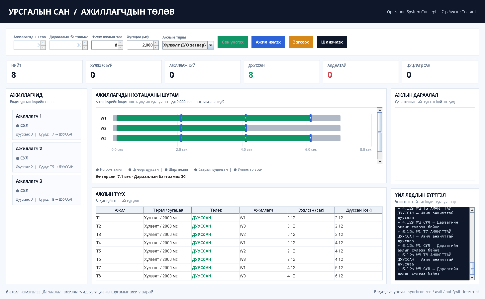

# БД2 — Давтан туршилтын бодит үр дүн

## Орчин
- ОС: **Debian GNU/Linux 13 (trixie)**, x86_64 (container); CPU: орчноос харагдсан 5 логик цөм; RAM: `/proc/meminfo`-д ~5.8 GiB. Эдгээр нь **багийн Mac-ийн үзүүлэлт биш**.
- Java: OpenJDK 21.0.12.1, javac 21.0.12.1.
- GUI: `xvfb-run -a -s '-screen 0 1600x1000x24' ...`.
- Нэмэлт framework/`ExecutorService` ашиглаагүй.

## Regression summary

| Туршилт | Өмнөх ZIP | Засварласан код | Дүгнэлт |
|---|---|---|---|
| `bash test.sh`: `PoolTests` | 7/7 PASS | 7/7 PASS | Үндсэн API хадгалагдсан |
| `TimelineTests` зогссон үеийн агшин | PASS | PASS | Өмнөх засвар эвдрээгүй |
| `TimelineBeforeAfterProbe`: 3001 ажлын эхний RUNNING зурвас | `earlyActivityShown=false` | `earlyActivityShown=true` | **P4 алдаа зассан** |
| `BD2RegressionTests` | Өмнө нь байгаагүй | 5/5 PASS | Нэмэлт стресс/lock/FIFO туршилт |
| `GuiSmokeTest` | Энд baseline GUI тусад нь ажиллуулаагүй | PASS | Сан үүсгэх → 8 ажил → reset |

### P4 ижил оролтын console үр дүн

**Өмнөх ZIP** (`ThreadPoolApp` нь 4000 event дээр тулгуурласан):

```
P4 probe | completed=3001, retainedEvents=4000, firstStartMs=20, firstFinishMs=370, oldestRetainedEventMs=386, earlyActivityShown=false
```

**БД2-ийн дараах код** (`ThreadPoolApp` нь TaskView тайминг дээр тулгуурласан):

```
P4 probe | completed=3001, retainedEvents=4000, firstStartMs=20, firstFinishMs=371, oldestRetainedEventMs=385, earlyActivityShown=true
```

Тайлбар: бодит ажиллагааны цаг нь орчноос хамаарч хэлбэлзэнэ; P4-ийн гол хэмжүүр нь `earlyActivityShown` юм. 3001 ажил бүгд амжилттай дууссан, өмнөх 4000 event-ийг log-с хассан байхад **эхний 100 мс орчимд ажиллаж байсныг шинэ timeline зөв ногооноор дүрсэлсэн**.

### Нэмэлт 5 тест

1. **3001 task / P4:** 4000 retained event, эхний task-ийг green хэлбэрээр зурах → PASS.
2. **P8 listener:** 400 мс удаан callback ажиллах үед pool `submit()` lock-д гацахгүй → PASS (энэ ажиллуулалтад 0 мс гэж round хийсэн).
3. **8 producer × 200:** accepted + rejected = 1600; accepted бүр нэг удаа дууссан → PASS.
4. **FIFO:** 1 worker 30 task-ийн дараалал зөв; create/shutdown 30 давталт → PASS.
5. **Snapshot:** 2000 ажлын үеийн 100 snapshot бүрд `submitted = queued + running + completed + failed + cancelled` → PASS.

### GUI screenshot



**Давтан ажиллуулах:**

```bash
bash test.sh
# Linux/Xvfb эсвэл дэлгэцтэй орчинд:
xvfb-run -a -s '-screen 0 1600x1000x24' java -Dfile.encoding=UTF-8 -cp out GuiSmokeTest
# Mac desktop дээр GUI нээх:
bash run.sh
```

**Энэ туршилтад хийгдээгүй зүйлс:** Mac/Windows-native GUI тест, GitHub-д tag үүсгэх, багийн гишүүдийн бодит commit history баталгаажуулалт. Performance-ийн бүх hardware дээрх ms-ийг ерөнхийлөн дүгнээгүй.
