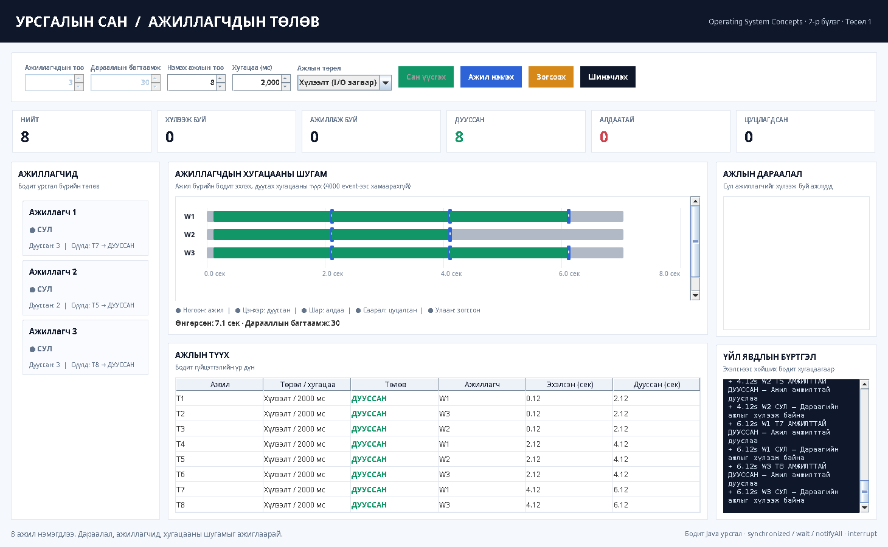

# V-1-9 — FINAL MANUAL (БД2)

**F.CSM302 Үйлдлийн систем — Designing a Thread Pool**  
**Баталгаажуулсан орчин:** Linux (Debian 13), OpenJDK 21.0.12.1, GUI/Xvfb. Mac/Windows-ын заавар өгсөн боловч тэдгээр систем дээр **энэ удаа тестлээгүй**.

## 1. Программ юу хийдэг вэ?

Хоолны газрын 3 тогооч (worker) ба дараалалтай захиалга (task) гэж төсөөлье. Захиалга ирэхэд сул тогооч ажиллана, завгүй бол FIFO дараалалд орно. Ажил дууссан тогооч дахин сул болж шинэ захиалга авна. Программ энэ зарчмыг жинхэнэ Java `Thread`, `Runnable`, `synchronized`, `wait()`, `notifyAll()`, `interrupt()` ашиглан харуулна. `ExecutorService` ашиглаагүй.

## 2. Суулгах шаардлага

- **Java JDK 17+**, санал болгох нь JDK 21 (зөвхөн JRE биш, `javac` хэрэгтэй).
- Terminal / Command Prompt; график desktop; нэмэлт Java library хэрэггүй.
- Repository: https://github.com/maralgoo-gan/BD1-9

## 3. Mac дээр ажиллуулах (Linux ижил)

1. Terminal нээгээд `git clone https://github.com/maralgoo-gan/BD1-9.git` гэж татна. Эсвэл ZIP-ээ задлаад үндсэн хавтсаа нээнэ.
2. `cd BD1-9`.
3. `java -version` ба `javac -version` командаар JDK-ийг шалгана.
4. `bash run.sh` гэж ажиллуулна.
5. **УРСГАЛЫН САН / АЖИЛЛАГЧДЫН ТӨЛӨВ** нэртэй цонх нээгдэнэ.
6. **Ажиллагчдын тоо 3, багтаамж 30, ажлын тоо 8, хугацаа 2000 мс, Хүлээлт** гэж сонгоно.
7. **Сан үүсгэх**, дараа нь **Ажил нэмэх** дарна. 3 ажил зэрэг эхэлж, үлдсэн 5 ажил FIFO дараалалд байна.
8. ~6 секундийн дараа **НИЙТ 8 / ДУУССАН 8 / ХҮЛЭЭЖ 0 / АЖИЛЛАЖ 0** болно. Timeline-д ажилласан хугацаа ногоон, дууссан агшин цэнхэрээр гарна.



## 4. Дэлгэцийн элементүүд

| Удирдлага | Үүрэг | GUI range |
|---|---|---|
| Ажиллагчдын тоо | Урьдчилан үүсгэх урсгалын тоо | 1–32 |
| Дарааллын багтаамж | FIFO queue-д хүлээж болох дээд хэмжээ | 1–1000 |
| Нэмэх ажлын тоо | Нэг удаад нэмж буй task | 1–100 |
| Хугацаа (мс) | Нэг ажлын хугацаа | 100–15000 |
| Ажлын төрөл | Хүлээлт / CPU тооцоолол / Алдаа шалгах | 3 төрөл |
| Сан үүсгэх | Шинэ pool, ажиллагч thread-үүдийг үүсгэнэ | Start |
| Ажил нэмэх | Task-уудыг FIFO queue-д нэмнэ | Add |
| Зогсоох | Хүлээгдсэн task-уудыг цуцална, worker-д interrupt өгнө | Stop |
| Шинэчлэх | Өмнөх pool бүрэн дууссаны дараа дахин тохируулах | Reset |

**Анхаар:** Java API-аар `ThreadPool(1..64, 1..10000)` үүсгэж болно. Харин энгийн хэрэглэгчийн UI-д ажиллагч 1–32, queue 1–1000 хязгаартай — хоёр хязгаар зориуд ялгаатай. Зарим буруу утгыг spinner өөрөө хориглоно; текст parsing алдаа гарвал UI мэдэгдэнэ.

## 5. Өнгө ба төлөв

- **СУЛ / IDLE:** саарал зурвас; worker дараагийн task-ийг `wait()`-ээр хүлээнэ.
- **АЖИЛЛАЖ БУЙ / RUNNING:** ногоон зурвас; worker `Runnable.run()` хийж байна.
- **ДУУССАН / COMPLETED:** цэнхэр босоо тэмдэг; task бүрэн дууссан, worker дахин сул болно.
- **АЛДААТАЙ / FAILED:** шар босоо тэмдэг; энэ task exception-оор дууссан ч worker ажиллах чадвартай хэвээр.
- **ЦУЦЛАГДСАН / CANCELLED:** бараан саарал босоо тэмдэг; ажил цуцлагдсан.
- **ЗОГССОН / STOPPED:** улаан ганц нарийн тэмдэг; worker зогссон **агшин**, үргэлжилсэн зурвас биш.

**БД2 сайжруулалт:** Timeline өмнө нь зөвхөн сүүлийн 4000 event-ийг ашигладаг байсан. Одоо бүх TaskView-ийн start/finish-ээс зурдаг тул 3001-аас дээш ажилд эхний түүх худал IDLE болж хувирахгүй. Үйл явдлын текстэн бүртгэл сүүлийн 4000 event-ийг л хадгална.

## 6. Гараар турших 3 жишээ

**А. Энгийн:** 3 worker, 8 task, 2000 мс, Хүлээлт. Эцэст 8/8 COMPLETED, 0 queued.

**Б. FIFO:** `Шинэчлэх` → worker 1, queue 30, task 8, 1000 мс. Нэг удаад нэг л ажил RUNNING, ажлууд дугаарын дагуу дараалан ажиллана.

**В. Cancellation:** worker 3, task 8, 8000 мс → ажил нэмсний дараа 1–2 секундэд **Зогсоох** дарна. Одоогоор RUNNING task cooperative interrupt-ээр CANCELLED, хүлээгдсэн task эхлэхгүйгээр CANCELLED болно. Worker-ууд STOPPED агшинтай.

## 7. Тест ажиллуулах

```bash
bash test.sh
```

Энэ скрипт 7 үндсэн тест, 1 timeline тест, БД2-ын 5 нэмэлт тест ажиллуулна. Headless тест тул график цонх шаардахгүй. GUI smoke test шаардлагатай бол compile хийсний дараа graphical desktop орчинд:

```bash
java -Dfile.encoding=UTF-8 -cp out GuiSmokeTest
```

Windows дээр `run.bat` болон `test.bat` бэлдсэн (энэ удаагийн Windows-н native тест хийгдээгүй).

## 8. Алдаа ба шийдэл

- `javac: command not found` → JDK суулга, terminal дахин нээгээд `javac -version` шалга.
- `Could not find or load main class Main` → төслийн үндсэн хавтсанд очоод `bash run.sh` ажиллуул.
- `Ажлын дараалал дүүрсэн` → ажлын багцыг багасга, queue capacity нэмэх бол **Шинэчлэх** дараад шинэ pool үүсгэ.
- `Ажил нэмэх` идэвхгүй → эхлээд **Сан үүсгэх** дар; зогссон pool-д шинээр ажил нэмэхгүй.
- Java GUI харагдахгүй → Desktop session байгаа эсэхийг шалга; headless Linux-д `xvfb-run` хэрэгтэй.

## 9. Хязгаарлалт / Known Issues

- `Runnable` нь interrupt-ийг үл тоовол хугацаанд нь зогсох баталгаа байхгүй. Зарим boundary race-ийн үед completed/cancelled төлөвийг generic `Runnable`-ийн дотоод логикоос 100% дүгнэх боломжгүй (шүүмж P7, хэсэгчлэн шийдсэн).
- `WorkTask`-ийн Хүлээлт нь бодит network/file I/O биш, `Thread.sleep()` загварчлал; CPU mode нь бодит тооцоолол хийнэ.
- Snapshot болон GUI-д олон мянган task байвал memory хэрэглээ өснө; зорилго нь thread pool-ийн үзүүлэн, production scheduler биш.
- Бодит Mac/Windows screenshot, GitHub final release/tag, багийн гишүүдийн commit бүртгэлийг publish хийх үед эцэслэнэ.

## 10. Нэр томьёоны тайлбар

| Нэр | Тайлбар |
|---|---|
| Thread / урсгал | Java-ийн бие даан гүйцэтгэх зам |
| Worker / ажиллагч | Pool-ийн урьдчилан үүсгэсэн thread |
| Task / ажил | `Runnable`-аар өгсөн нэг ажил |
| FIFO queue / дараалал | Түрүүлж орсон task түрүүлж очдог өгөгдлийн бүтэц |
| Lock / түгжээ | Shared queue/state-д нэг дор нэг worker хандах хяналт |
| wait / notifyAll | Хүлээх worker-ийг унтуулах / шинэ ажил ирэхэд сэрээх |
| Interrupt | Зогсоох хүсэлтийн дохио; хүчээр thread устгах биш |
| Snapshot | Тухайн агшны pool-ийн өөрчлөгдөхгүй өгөгдлийн зураглал |
