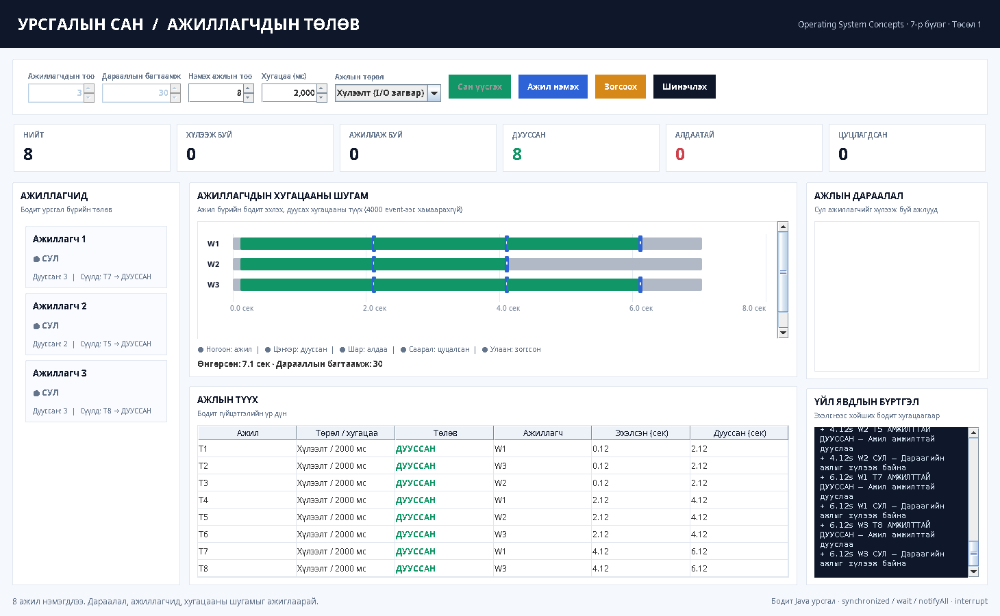

# БИЕ ДААЛТ 2 — FINAL REPORT (DRAFT)

**F.CSM302 Үйлдлийн систем**  
**Төслийн нэр:** Designing a Thread Pool — Урсгалын сан / Ажиллагчдын төлөв  
**Хуваарилалтын код:** V-1-9  
**Repository:** https://github.com/maralgoo-gan/BD1-9  
**Багийн гишүүд, ажил үүрэг, бодит commit:** *Багийн гишүүд GitHub-д нийтэлсний дараа баталгаажуулж оруулах хэсэг*  
**Final release / commit / tag:** *Одоогоор баталгаажаагүй; баг нийтлэсний дараа яг ижил hash/tag-ийг Report ба GitHub-д тусгана*  
**2026 он**

> Энэхүү хувилбар нь **бодит Linux тестийг** тусгасан БД2 материал. Mac/Windows тест, багийн гишүүдийн мэдээлэл, GitHub release-ийг зохиомлоор бөглөөгүй учир эцэслэхээс өмнө нөхнө.

## Хураангуй

БД1-ээр Java `Thread` болон `Runnable` ашиглан `ExecutorService`-гүй Thread Pool хэрэгжүүлж, Swing график орчинд worker-ийн төлөвийг хугацааны шугамаар харуулсан. II-4-13 багийн review-д үндсэн синхрончлол, FIFO, shutdown болон автомат тестүүд сайн үнэлэгдсэн ч timeline 4000 event-ийн дараа худал IDLE дүрслэх (P4), UI шинэчлэлийн ачаалал (P8), өнгө/баримтжуулалт (P1–P3, P5–P6) асуудлуудыг илрүүлсэн. БД2-д ажил бүрийн бодит эхлэх, дуусах хугацаанаас timeline зурах, UI polling/incremental table, event log deque, тусдаа төлөвийн өнгө, нэмэлт тест болон Manual/README шинэчлэл хийсэн. 3001 ажлын ижил P4 шалгалтад **өмнө `earlyActivityShown=false`, дараа `true`** гарч засвар батлагдсан. Үндсэн 7 тест, timeline regression, БД2-ын 5 нэмэлт тест, GUI smoke test шинэ хувилбар дээр тэнцсэн.

## 1. Төслийн тойм

Thread Pool нь олон task-ийг урьдчилан үүсгэсэн хязгаартай тооны worker thread-ээр гүйцэтгэх механизм. Энэ нь thread бүрийг шинээр үүсгэх шаардлагыг багасгаж, дараалалд хүлээх болон worker-ийн дахин ашиглалтыг дүрслэхэд зориулагдсан. Сурах бичиг: *Operating System Concepts, 10th edition* (2018), Chapter 7, Programming Project 1 (Java variant). API: `ThreadPool()`, `ThreadPool(int size)`, `add(Runnable)`, `shutdown()`; worker idle/wait, notify, FIFO, interrupt механизм. Багшийн нэмэлт шаардлага: параметрүүдийг өөрчилж, worker activity timeline харуулах.

**БД1 суурь:** `ThreadPool.java`, `WorkTask.java`, `ThreadPoolApp.java`, `Main.java`; `run.sh`, `test.sh`, Swing UI, workload ба event log.

**Review-ийн хүчтэй тал:** 7/7 эх тест PASS; шүүмжлэгчдийн 19 нэмэлт тестээс үндсэн concurrency/FIFO/snapshot test-үүд PASS; `shutdown()` болон GUI-ийн гол үйлдэл ажилласан. Шүүмжийн P4 нь зөвхөн UI зурлагын асуудал байсан тул worker execution-ийг эвдэхгүйгээр засварлав.

## 2. Эцсийн архитектур

```text
User controls (workers, capacity, batch, mode, duration)
                  |
                  v
           Swing ThreadPoolApp
                  | create / submit / shutdown
                  v
             ThreadPool API
                  |
          +-------+-------+
          |   FIFO queue  |  shared synchronized(lock)
          +-------+-------+
                  |
       +----------+----------+
       |          |          |
     Worker 1   Worker 2   Worker 3 ...
       |          |          |
       +--- Runnable.run() --+
                  |
        TaskView (start/finish/state)
                  |
         Immutable Snapshot (150 ms)
                  |
         Swing timeline / table / metrics
```

**`workerLoop()` гол алхмууд:** (1) queue хоосон үед `while (queue.isEmpty() && !shuttingDown) lock.wait()`; (2) shutdown бол гарна; (3) `removeFirst()`-ээр FIFO task авна; (4) `RUNNING` ба timestamp бүртгэнэ; (5) **lock-ийн гадна** `Runnable.run()` дуудна; (6) COMPLETED/FAILED/CANCELLED-ийг бүртгэнэ; (7) worker-ийг дахин IDLE болгож дараагийн ажлыг хүлээнэ; (8) shutdown үед worker `STOPPED` бөгөөд timestamp үлдээнэ. Lock-ийн гадна `run()` гүйцэтгэхгүй бол бусад worker зэрэг ажиллаж чадахгүй.

**БД2-ийн өөрчлөлт:** Сүүлийн 4000 event лог нь зөвхөн дэлгэцийн бүртгэлд ашиглагдах ба Timeline нь бүх TaskView-ийн `startMillis/finishMillis`-ээс зурна. STOPPED timestamp `WorkerView.stoppedMillis`-д хадгалагдана. Swing нь event бүрд callback авахын оронд 150 мс тутам snapshot авч, table-ийн зөвхөн өөрчлөгдсөн мөр/нүдийг шинэчилнэ. Optional listener-ийг lock-ийн гадна дуудаж, 100 мс rate limit хэрэглэнэ.

## 3. Туршилт ба дүрслэл

Оролтын параметр: 1–32 worker, 1–1000 queue, 1–100 task/batch, 100–15000 мс, Хүлээлт / CPU / Алдаа. БД2 шинэ legend: **ногоон RUNNING**, **саарал IDLE**, **цэнхэр COMPLETED**, **шар FAILED**, **бараан саарал CANCELLED**, **улаан STOPPED**. STOPPED нь агшин, тасралтгүй үргэлжлэх зурвас биш.



Дээрх зурагт Нийт=8, Дууссан=8, ажиллаж=0, хүлээж=0. Worker-ийн 3+3+2 багц ажлыг ногоон зурвас болон дууссан цэнхэр тэмдэгтээс харж болно. Зураг **бодит GUI-ээс 2026-11-22-ны энэ ажлын явцад** Linux/Xvfb дээр авсан; зохиомол зураг биш.

## 4. Reviewer Comments and Responses

Шүүмжлэгч: **II-4-13**; шүүмжлэгдсэн баг: **V-1-9**. Review-ийн 13–16-р хуудсанд дурдсан P1–P8, P10; сайжруулалтын 16–17-р хуудсын P9–P12-ыг мөн хамруулав. `BD2_REVIEW_RESPONSES.md`-д бүрэн шийдвэр, үндэслэл, статус байгаа.

| ID | Шүүмж | Priority | Шийдвэр | Өөрчлөлт / нотолгоо |
|---|---|---|---|---|
| P1 | README, Release | Major | Зөвшөөрсөн | README зассан; release publish үлдсэн |
| P2 | Manual/Report дутуу | Major | Зөвшөөрсөн | шинэ Manual/Report draft, Linux нотолгоо; Mac ба гишүүдийн мэдээлэл үлдсэн |
| P3 | GitHub/AI/оролцоо | Major | Зөвшөөрсөн | тайлбар болон AI тэмдэглэл; бодит commit үлдсэн |
| P4 | 4000 event-ээс timeline худал | Major | Зөвшөөрсөн | TaskView суурьтай timeline; 3001 before=false/after=true |
| P5 | Улаан өнгө давхцсан | Minor | Зөвшөөрсөн | FAILED шар; CANCELLED саарал; STOPPED улаан |
| P6 | Validation/range зөрүү | Minor | Хэсэгчлэн | `commitEdit`; GUI/API range ялгааг тайлбарласан |
| P7 | Shutdown state race | Minor | Хэсэгчлэн | Known Issues; generic Runnable-ийн таслалт 100% баталгаагүй |
| P8 | Lock дотор listener, хэт олон snapshot | Minor | Зөвшөөрсөн | 150 мс polling, incremental table, listener lock-гүй |
| P9 | Нэмэлт тест | Suggestion | Зөвшөөрсөн | BD2RegressionTests 5/5, GUI smoke |
| P10 | Windows support | Suggestion | Хэсэгчлэн | run.bat/test.bat, Windows-native test үлдсэн |
| P11 | Diagram/glossary | Suggestion | Зөвшөөрсөн | энэ диаграм, workerLoop, Manual glossary |
| P12 | Алхамчилсан guide | Suggestion | Зөвшөөрсөн | Manual-ийн 8 алхам |

Зөвшөөрөөгүй санал үлдээгээгүй; харин P6, P7, P10-ыг **хэсэгчлэн зөвшөөрсөн** техникийн шалтгааныг `BD2_REVIEW_RESPONSES.md`-д тусгасан. GitHub commit/tag гараагүй байхад зохиомол hash оруулаагүй.

## 5. Дахин туршилт / Regression

**Бодит орчин:** Debian GNU/Linux 13 x86_64, OpenJDK/Javac 21.0.12.1, Linux/Xvfb 1600×1000. Энэ нь **багийн macOS биш**.

| Тест | Өмнө | Дараа | Үр дүн |
|---|---|---|---|
| Үндсэн PoolTests | 7/7 PASS | 7/7 PASS | Regression хадгалсан |
| Stopped timeline test | PASS | PASS | Зогссон үе царцах, red суналтгүй |
| 3001 task first-100ms timeline (P4) | false | true | Алдааг зассан |
| 400 мс listener callback (P8) | Шинэ тест | PASS | `submit()` lock-д удаан хориглогдохгүй |
| 8 × 200 producers / P9 | Шинэ тест | PASS | 1600 хүсэлт тооцоо таарсан |
| FIFO 30 / lifecycle 30 | Шинэ тест | PASS | FIFO болон resource cleanup |
| 2000 task, 100 snapshot invariant | Шинэ тест | PASS | Нийт = төлөвүүдийн нийлбэр |
| GUI 8-job smoke test | Тусад нь baseline GUI шалгаагүй | PASS | Start/Add/Reset ажилласан |

**Ижил 3001 ажлын P4 probe console:**

- BD1 ZIP: `completed=3001, retainedEvents=4000, firstStartMs=20, firstFinishMs=370, oldestRetainedEventMs=386, earlyActivityShown=false`
- BD2 засвар: `completed=3001, retainedEvents=4000, firstStartMs=20, firstFinishMs=371, oldestRetainedEventMs=385, earlyActivityShown=true`

Ижил ачааллын туршилтад эхний RUNNING үед green pixel байгаа эсэхийг бодит Swing `paint()`-ээр шалгасан. `firstStartMs/finishMs` тоон үзүүлэлт ажиллуулах бүрд бага зэрэг хэлбэлзэнэ.

## 6. Эцсийн үр дүн

- **Төлөвийн үнэн зөв байдал:** P4-ийг before/after дүрслэлийн тестээр зассаныг нотолсон.
- **Олон ажлын найдвартай байдал:** 3001 task бүгд дууссан; 8 producer-ийн 1600 оролдлогын бүх accepted task нэг удаа гүйцэтгэсэн; 2000 task snapshot invariant зөрчөөгүй.
- **Өмнөх боломж:** Номын үндсэн `ThreadPool` API, 7 үндсэн тест, Swing GUI хадгалагдсан.
- **Хэрэглэхэд ойлгомжтой:** өнгө ялгасан legend, parsing notification, алхамчилсан Manual нэмсэн.

Эдгээр хэмжилт нь нэг Linux орчин дахь дахин тест юм. Өөр ОС/төхөөрөмж дээр ижил хурд амлахгүй.

## 7. Хязгаарлалт ба ил тод хэрэглээ

- **P7:** `Runnable` interrupt-ийг үл тоох эсвэл exception залгих үед ажил үнэхээр дууссан эсэхийг pool бүрэн таних боломжгүй. Зөвхөн interrupt-ийг хамтран боловсруулах ажлуудад cancellation-ийн тайлбар бүрэн хүчинтэй.
- **Оролт:** API range 1–64 worker/1–10000 queue, харин UI range 1–32 worker/1–1000 queue зориуд ялгаатай.
- **Өмнө/дараах хэмжилт:** БД1 baseline-ийн GUI smoke test тусад нь хэмжээгүй; одоогийн бодит GUI Xvfb тест хийсэн.
- **Платформ:** Mac/Windows-native програмыг энэ ажлын орчинд ажиллуулаагүй. Windows batch файлууд бичсэн боловч туршаагүй.
- **AI disclosure:** Энэ БД2-ын кодын засварын хувилбар, нэмэлт тест, баримтжуулалтын эхийг боловсруулахад **OpenAI ChatGPT**-ийг туслах хэрэгсэл болгон ашигласан; бодит тестийн командуудыг ажиллуулж шалгасан. Сурах бичгийн стандарт API ба Java-ийн үндсэн сан ашигласан; бэлэн ExecutorService-ээр Thread Pool бүтээхгүй.
- **Гишүүд/commit:** бодит хувь хүний оруулсан хувь нэмэр, branch, commit-ийг багийн гишүүд өөрсдөө баталгаажуулах ёстой; зохиож оруулаагүй.

## 8. Дүгнэлт

БД1-ийн зөв ажиллаж байсан concurrency ба FIFO механизмийг хадгалж, reviewer-ийн гол P4 дүрслэлийн алдааг TaskView-based timeline-ээр зассан. P8-д callback/data/UI шинэчлэлийн давтамжийг хязгаарлаж, хүснэгтийн incremental update хийсэн. P5 өнгөний давхардал, P2/P3/P11/P12 баримтжуулалтын сул талыг сайжруулсан. 7 үндсэн + 1 timeline + 5 нэмэлт headless тест, GUI smoke test Linux/Xvfb дээр тэнцсэн. Хязгаарлалт P7, Windows/Mac-native тест, GitHub final release/commit бүртгэл зэрэг **нээлттэй ажлуудыг** нуухгүйгээр тайлагнасан.

## Ашигласан материал

1. Silberschatz, Galvin, Gagne. *Operating System Concepts*, 10th ed., 2018, Chapter 7 Programming Project.
2. F.CSM302. *OS_BD2_Guide.pdf*, 2026, хуудас 2–7.
3. II-4-13. *V-1-9-review.pdf*, 2026, 18 хуудас, P1–P12.
4. Java SE 21 стандарт `Thread`, `Runnable`, `Object.wait/notifyAll` API.
5. V-1-9 repository: https://github.com/maralgoo-gan/BD1-9
